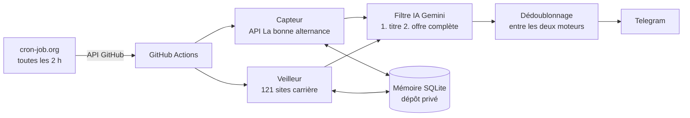

# Agent IA de veille des offres d'alternance

Agent automatique qui surveille les nouvelles offres d'**alternance en informatique** partout en France (développement, DevOps/Cloud, data, IA, cybersécurité, systèmes et réseaux, support, ERP, QA). Il envoie sur Telegram, dans les deux heures, **uniquement** les offres pertinentes.

> Projet personnel, réalisé en octobre 2026 par Trésor Virenque Fowe Takam, élève ingénieur à l'ISEN Nantes (DevOps / Cloud).

## Le problème

Une offre d'alternance peut être publiée de cinq façons différentes. Une recherche manuelle sur un jobboard n'en couvre qu'une partie :

| Cas | Situation | Couverture |
|---|---|---|
| 1 | L'entreprise publie partout | ✅ Capteur |
| 2 | Entreprise connue, offres seulement sur son site | ✅ Veilleur (121 sites) |
| 3 | Entreprise connue, sans offre aujourd'hui | ✅ Veilleur : alerte dès qu'une offre apparaît |
| 4 | Entreprise inconnue, présente sur les jobboards | ✅ Capteur, toute la France |
| 5 | Entreprise inconnue, offres seulement sur son site | ❌ Limite assumée (voir plus bas) |

## Architecture



- **Capteur** (`capteur.py`) : balaie toute la France à partir de l'API officielle [La bonne alternance](https://labonnealternance.apprentissage.beta.gouv.fr/), qui regroupe France Travail et une dizaine de jobboards partenaires. Il garde en mémoire toutes les offres déjà vues.
- **Veilleur** (`veilleur.py`) : visite 121 pages carrière et relève les offres nouvelles.
  - Les pages ordinaires sont ouvertes avec un navigateur automatisé (Playwright).
  - Greenhouse, Lever, SmartRecruiters et Recruitee sont lus par leurs interfaces publiques officielles (`connecteurs.py`).
  - Workday est lu en page publique, filtrée sur la France et le type de contrat, pages suivantes comprises.
- **Filtre IA** (`filtre_ia.py`) : Gemini juge en deux étapes.
  1. Tri sur le titre, par paquets de 50.
  2. Lecture de l'offre complète pour les titres retenus. Il exige une preuve, applique une frontière du métier écrite noir sur blanc et répond « oui », « non » ou « à vérifier ».
  - Les règles qui doivent être sûres sont appliquées par le code, pas par l'IA. Exemples : un stage ou un CDI annoncé dans le titre, ou une offre de site carrière qui ne mentionne jamais l'alternance.
- **Dédoublonnage** (`dedoublon.py`) : une même offre vue par les deux moteurs n'est envoyée qu'une fois. Deux offres sont considérées comme identiques si leur titre simplifié est le même et qu'elles ont la même entreprise ou le même code postal.
- **Configuration** (`config.py`) : sépare la production (GitHub Actions uniquement) du mode test (copie locale de la mémoire, messages affichés au lieu d'être envoyés).

## Automatisation

- `.github/workflows/agent.yml` est déclenché toutes les deux heures par **cron-job.org** via l'API GitHub (`workflow_dispatch`). Le planificateur intégré de GitHub abandonnait 8 créneaux sur 13 ; depuis le changement, aucun n'est manqué.
- La mémoire de l'agent (`veilleur.db`) vit dans un **dépôt privé séparé**. Le code reste public. La mémoire est sauvegardée à raison d'une version par jour, et l'historique est conservé.
- Si une étape échoue, une alerte part sur Telegram. Le silence signifie donc toujours « rien de nouveau ».
- Les secrets (Telegram, La bonne alternance, Gemini, accès au dépôt de données) sont stockés dans les secrets GitHub et ne figurent jamais dans le code.

## Règles d'accès aux sites

- Seules les interfaces publiques **officielles et documentées** sont utilisées. Les pages publiques sont lues comme le ferait un visiteur.
- Le fichier `robots.txt` est respecté : un site qui l'interdit n'est pas lu.
- **Ni LinkedIn, ni Indeed, ni Welcome to the Jungle** : leurs conditions d'utilisation interdisent la collecte.
- L'usage reste léger : 12 passages par jour, et la description d'une offre n'est demandée qu'une seule fois.
- L'API La bonne alternance est utilisée dans un cadre non commercial.

## Résultats (mesurés du 25 au 29 octobre 2026)

| Indicateur | Valeur |
|---|---|
| Passages réalisés | 49 / 49 prévus pour le capteur, 48 pour le veilleur |
| Durée moyenne d'un passage | 24 min (capteur), 20 min (veilleur) |
| Nouvelles offres lues | environ 7 400 en 4 jours |
| Offres envoyées | 43, soit une dizaine par jour |
| Entreprises du veilleur ayant rapporté une offre retenue | 21 sur 122 |

Pour mesurer le bruit, la première version filtrée par mots-clés a été comparée au filtre en deux étapes : 365 alertes avec la première, 15 avec le second, sur le même passage. Les offres rejetées ont été relues à chaque mise en service, et aucune offre pertinente perdue n'a été trouvée.

## Limites connues

- **Cas 5 non couvert.** Les données disponibles proprement ne contiennent que des micro-entreprises, sans site web. Les sources qui permettraient mieux sont exclues par les règles d'accès. Le « découvreur » prévu a été mesuré, puis abandonné plutôt que de tourner sans effet.
- **Beaucoup de « à vérifier » côté veilleur.** Sur certains sites carrière, la description ne peut pas être lue (pages anti-robot, contenu en JavaScript). L'IA ne tranche alors pas et signale l'offre au lieu de la jeter.
- **Quatre sites bloqués par intermittence** depuis les serveurs de GitHub, et quelques sites retirés faute d'accès autorisé.

## Organisation du dépôt

| Fichier | Rôle |
|---|---|
| `capteur.py` | Collecte via l'API La bonne alternance |
| `veilleur.py` | Surveillance des sites carrière |
| `connecteurs.py` | Interfaces officielles des plateformes de recrutement, règles Workday, robots.txt |
| `filtre_ia.py` | Jugement des offres par Gemini (titre, puis offre complète) |
| `dedoublon.py` | Dédoublonnage entre les deux moteurs |
| `config.py` | Choix production / test, envoi Telegram, journal des passages |
| `preparer_test.sh` | Prépare une copie de test de la mémoire |
| `envoyer_pages.sh` | Envoie la liste des pages à surveiller au dépôt de données, entre deux passages |
| `exploration/` | Scripts de mesure en lecture seule, écrits avant chaque décision (couverture, accès aux plateformes, découvreur, bilan) |

## Tester en local

```bash
python -m venv .venv && source .venv/bin/activate
pip install requests python-dotenv pandas openpyxl playwright && playwright install chromium
# créer un fichier .env avec ses propres clés : TELEGRAM_TOKEN, TELEGRAM_CHAT_ID, LBA_API_KEY, GEMINI_API_KEY
./preparer_test.sh              # copie de la mémoire dans data_test/
MODE=test RAPIDE=1 python capteur.py
```

En production, l'agent refuse de se lancer en dehors de GitHub Actions.

## Compétences mises en œuvre

Python, intégration d'API REST, Playwright, SQLite, intégration d'un modèle de langage (sortie structurée, gestion des erreurs et des quotas), GitHub Actions (secrets, accès à un second dépôt, concurrence, alertes d'échec), séparation du code et des données, séparation production / test, mesure avant décision.
